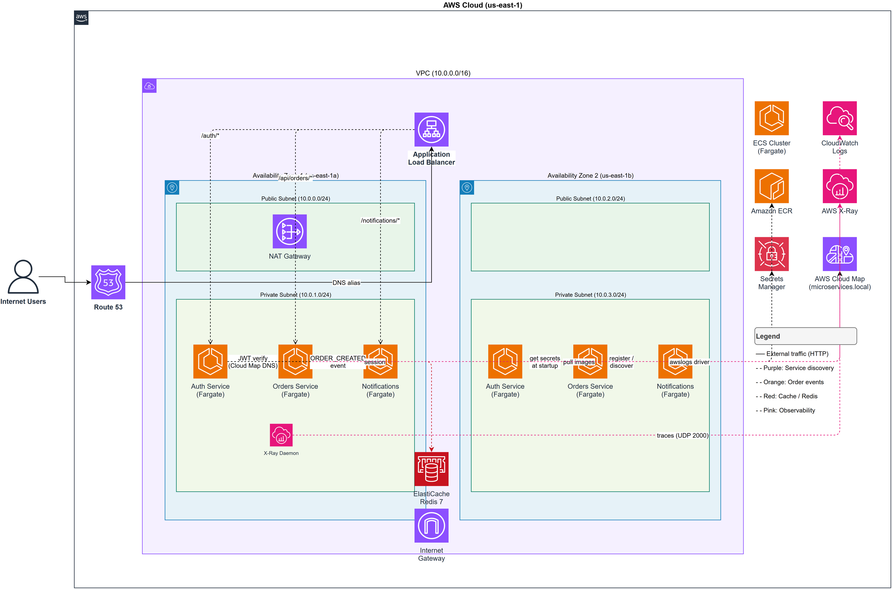

# AWS ECS Fargate — Microservices Infrastructure

Production-grade AWS infrastructure for a containerized microservices architecture, fully provisioned with **Terraform**. Three independent services run on **ECS Fargate** in private subnets behind an **Application Load Balancer**, with auto scaling, service discovery, and centralized observability.

---

## Architecture



```
Internet → ALB (path-based routing)
              ├── /auth/*          → Auth Service        (ECS Fargate)
              ├── /api/orders/*    → Orders Service       (ECS Fargate)
              └── /notifications/* → Notifications Service (ECS Fargate)

All services → ElastiCache Redis  (session cache)
All services → AWS Cloud Map      (service discovery — microservices.local)
All services → Secrets Manager    (credentials injected at startup)
All services → CloudWatch Logs + X-Ray (observability)
```

---

## AWS Services

| Layer | Service | Purpose |
|---|---|---|
| Compute | ECS Fargate | Serverless container runtime — no EC2 to manage |
| Networking | VPC, ALB, Security Groups | Isolated network with path-based routing |
| Registry | ECR | Private Docker image registry with vulnerability scanning |
| Discovery | AWS Cloud Map | DNS-based service-to-service discovery |
| Cache | ElastiCache Redis | Shared session store across stateless containers |
| Secrets | Secrets Manager | Encrypted credentials injected at container startup |
| Observability | CloudWatch Logs, X-Ray | Centralized logs and distributed tracing |
| Auto Scaling | Application Auto Scaling | Target-tracking policies on CPU and memory per service |
| DNS | Route 53 | Alias record pointing to ALB |

---

## Infrastructure

All AWS resources are provisioned with **Terraform**.

```
terraform/
├── main.tf           # Provider, backend, and locals
├── vpc.tf            # VPC, public/private subnets, NAT Gateway (2 AZs)
├── ecr.tf            # ECR repositories + lifecycle policies
├── alb.tf            # ALB, target groups, path-based listener rules
├── ecs.tf            # ECS cluster, task definitions, Fargate services
├── autoscaling.tf    # Application Auto Scaling — CPU and memory target tracking
├── cloudmap.tf       # Private DNS namespace + service registry
├── elasticache.tf    # Redis cluster in private subnets
├── secrets.tf        # Secrets Manager secrets
├── iam.tf            # Task execution role + per-service task roles
├── variables.tf      # All configurable inputs
└── outputs.tf        # ALB DNS, ECR URLs, cluster name, scaling config
```

---

## Auto Scaling

Each ECS service is registered with **Application Auto Scaling** and controlled by two independent target-tracking policies:

| Policy | Metric | Target | Scale-out cooldown | Scale-in cooldown |
|---|---|---|---|---|
| CPU | `ECSServiceAverageCPUUtilization` | 70 % | 60 s | 300 s |
| Memory | `ECSServiceAverageMemoryUtilization` | 80 % | 60 s | 300 s |

Task count is bounded between `min_capacity` (default **2**) and `max_capacity` (default **6**). The minimum of 2 guarantees high availability across both Availability Zones at all times.

---

## Deploying to AWS

### Prerequisites

- AWS CLI configured (`aws configure`)
- Terraform ≥ 1.5

### 1 — Provision infrastructure

```bash
make init
make plan
make apply
```

Terraform outputs the ALB DNS name, ECR repository URLs, and cluster name on completion.

### 2 — Push container images to ECR

```bash
aws ecr get-login-password --region us-east-1 \
  | docker login --username AWS \
    --password-stdin <ACCOUNT_ID>.dkr.ecr.us-east-1.amazonaws.com

docker build -t auth-service .
docker tag auth-service:latest <ECR_URL>/auth-service:latest
docker push <ECR_URL>/auth-service:latest
```

Repeat for `orders-service` and `notifications-service`.

### 3 — Set the JWT secret

```bash
aws secretsmanager put-secret-value \
  --secret-id "ecs-microservices-prod/jwt-secret" \
  --secret-string "$(openssl rand -base64 48)"
```

### 4 — Verify deployment

```bash
ALB=$(terraform -chdir=terraform output -raw alb_dns_name)
curl http://$ALB/auth/health
```

### Teardown

```bash
make destroy
```

---

## Security

- Containers run in **private subnets** — not reachable from the internet
- Each service has a dedicated **IAM task role** with least-privilege policies
- Credentials injected from **Secrets Manager** at startup — never in environment files or images
- ECR scans images for vulnerabilities on every push
- ALB security group allows only ports 80/443; ECS security group allows only traffic from ALB

---

## Estimated Cost (us-east-1)

| Resource | Monthly estimate |
|---|---|
| ECS Fargate (3 services × 0.25 vCPU / 512 MB) | ~$25 |
| ALB | ~$18 |
| ElastiCache Redis (cache.t3.micro) | ~$15 |
| NAT Gateway | ~$35 |
| ECR, CloudWatch, Secrets Manager | ~$5 |
| **Total** | **~$98 / month** |

Run `make destroy` when not in use to avoid charges.
