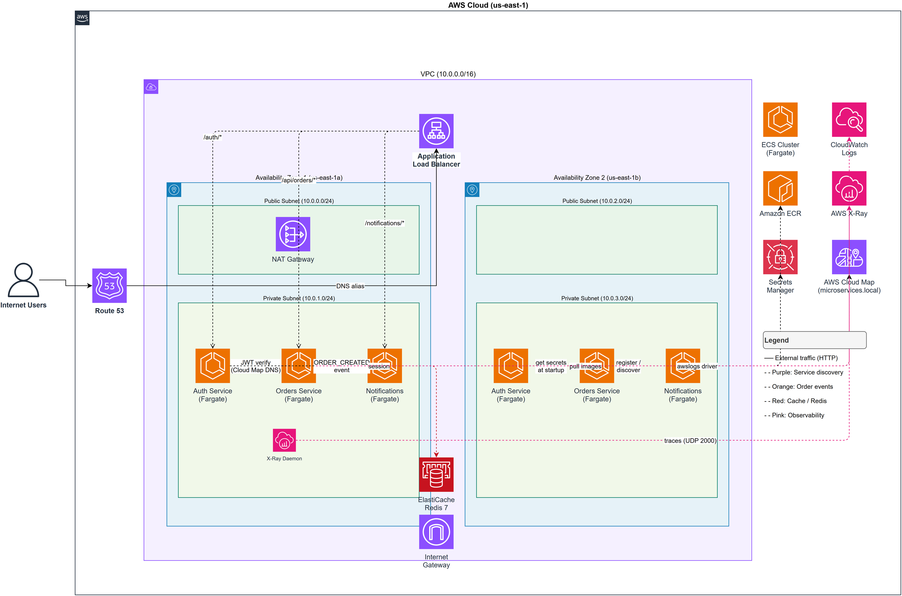

# AWS ECS Fargate — Containerized Microservices

A production-grade microservices architecture deployed on **Amazon ECS Fargate** with Terraform-managed infrastructure, blue/green deployments, and distributed tracing via AWS X-Ray.

---

## Architecture



The system is composed of three independent microservices behind an **Application Load Balancer**, running on ECS Fargate in private subnets across two Availability Zones.

```
Internet → Route 53 → ALB (path-based routing)
              ├── /auth/*          → Auth Service        (ECS Fargate)
              ├── /api/orders/*    → Orders Service       (ECS Fargate)
              └── /notifications/* → Notifications Service (ECS Fargate)

All services → ElastiCache Redis  (session cache)
All services → AWS Cloud Map      (service discovery)
All services → Secrets Manager    (JWT secret, Redis URL)
All services → CloudWatch Logs + X-Ray (observability)
```

---

## AWS Services

| Layer | Service | Purpose |
|---|---|---|
| Compute | ECS Fargate | Serverless container runtime — no EC2 to manage |
| Networking | VPC, ALB, Security Groups | Isolated network with path-based routing |
| Registry | ECR | Private Docker image registry with vulnerability scanning |
| Discovery | AWS Cloud Map | DNS-based service-to-service discovery (`microservices.local`) |
| Cache | ElastiCache Redis | Shared session store across stateless container instances |
| Secrets | Secrets Manager | Encrypted credentials injected at container startup |
| Observability | CloudWatch Logs, X-Ray | Centralized logs and distributed tracing across all services |
| CI/CD | CodePipeline, CodeDeploy | Blue/green deployments with automatic rollback |
| DNS | Route 53 | Alias record pointing to ALB with health checks |

---

## Services

### Auth Service — `POST /auth/register` · `POST /auth/login` · `GET /auth/verify`

Handles user registration, password hashing (bcrypt), and JWT issuance. Other services validate tokens by calling `/auth/verify` internally via Cloud Map DNS resolution.

### Orders Service — `GET|POST /api/orders` · `GET|PUT|DELETE /api/orders/:id`

Full CRUD for orders. Enforces JWT authentication on every route, calculates order totals, and fires an event to the Notifications Service on each new order. Returns 403 for cross-user access attempts.

### Notifications Service — `POST /notifications` · `GET /notifications` · `GET /notifications/:id`

Receives order lifecycle events from the Orders Service and stores them for audit and delivery. Operates as an internal service — no direct public auth required.

---

## Infrastructure

All AWS resources are provisioned with **Terraform**.

```
terraform/
├── main.tf           # Provider and locals
├── vpc.tf            # VPC, public/private subnets, NAT Gateway (2 AZs)
├── ecr.tf            # ECR repositories + lifecycle policies
├── alb.tf            # ALB, target groups, path-based listener rules
├── ecs.tf            # ECS cluster, task definitions, Fargate services
├── cloudmap.tf       # Private DNS namespace + service registry
├── elasticache.tf    # Redis cluster in private subnets
├── secrets.tf        # Secrets Manager secrets
├── iam.tf            # Task execution role + per-service task roles
├── variables.tf      # All configurable inputs
└── outputs.tf        # ALB DNS, ECR URLs, cluster name
```

---

## Deploying to AWS

### Prerequisites

- AWS CLI configured (`aws configure`)
- Terraform ≥ 1.5
- Docker

### 1 — Build and push images to ECR

```bash
# Authenticate Docker with ECR
aws ecr get-login-password --region us-east-1 \
  | docker login --username AWS \
    --password-stdin <ACCOUNT_ID>.dkr.ecr.us-east-1.amazonaws.com

# Build and tag
docker build -t auth-service ./app/auth-service
docker tag auth-service:latest <ACCOUNT_ID>.dkr.ecr.us-east-1.amazonaws.com/ecs-microservices-prod-auth-service:latest

# Repeat for orders-service and notifications-service, then push all three
docker push <ACCOUNT_ID>.dkr.ecr.us-east-1.amazonaws.com/ecs-microservices-prod-auth-service:latest
```

Or use the helper script:

```bash
AWS_ACCOUNT_ID=<your-account-id> AWS_REGION=us-east-1 bash scripts/build.sh
```

### 2 — Provision infrastructure

```bash
cd terraform
terraform init
terraform plan -out=tfplan
terraform apply tfplan
```

Terraform outputs the ALB DNS name on completion.

### 3 — Set the JWT secret

The JWT secret is created by Terraform but its value must be set manually — never stored in code:

```bash
aws secretsmanager put-secret-value \
  --secret-id "ecs-microservices-prod/jwt-secret" \
  --secret-string "$(openssl rand -base64 48)"
```

### 4 — Verify deployment

```bash
ALB=$(terraform output -raw alb_dns_name)

curl -X POST http://$ALB/auth/register \
  -H "Content-Type: application/json" \
  -d '{"email":"test@example.com","password":"Test123!","name":"Test User"}'

TOKEN=$(curl -s -X POST http://$ALB/auth/login \
  -H "Content-Type: application/json" \
  -d '{"email":"test@example.com","password":"Test123!"}' | jq -r .token)

curl http://$ALB/api/orders -H "Authorization: Bearer $TOKEN"
```

### Teardown

```bash
terraform destroy
```

---

## CI/CD

GitHub Actions runs on every push:

- **CI pipeline** — installs dependencies, runs Jest tests for all three services, builds Docker images
- **Terraform validate** — checks formatting and validates HCL on every change to `terraform/`

Blue/green deployments to ECS are handled by **AWS CodeDeploy**, configured in `terraform/ecs.tf`. A failed health check triggers automatic rollback to the previous task definition.

---

## Local Development

```bash
cp .env.example .env
docker compose up -d
```

Services available at `http://localhost` via NGINX reverse proxy. The local stack mirrors the AWS architecture — NGINX replaces ALB, Docker networking replaces Cloud Map DNS.

---

## Security

- Containers run in **private subnets** — not directly reachable from the internet
- Each service has a dedicated **IAM task role** with least-privilege policies
- Credentials are injected from **Secrets Manager** at container startup — never in environment files or images
- ECR scans images for vulnerabilities on every push
- ALB security group allows only ports 80/443; ECS security group allows only traffic from ALB

---

## Estimated Cost (us-east-1)

| Resource | Monthly estimate |
|---|---|
| ECS Fargate (3 services × 0.25 vCPU / 512 MB) | ~$25 |
| ALB | ~$18 |
| ElastiCache Redis (cache.t3.micro) | ~$15 |
| NAT Gateway | ~$35 |
| ECR, CloudWatch, Secrets Manager | ~$5 |
| **Total** | **~$98 / month** |

Run `terraform destroy` when not in use to avoid charges.

---

## Terraform Plan

The output below was produced by `terraform plan` against the full `terraform/` directory (hashicorp/aws v5.100.0, region `us-east-1`). All 58 resources are net-new — **no existing infrastructure is modified or destroyed.**

<details>
<summary>Show full plan output</summary>

```
Terraform used the selected providers to generate the following execution
plan. Resource actions are indicated with the following symbols:
  + create

Terraform will perform the following actions:

  # aws_cloudwatch_log_group.auth_service will be created
  + resource "aws_cloudwatch_log_group" "auth_service" {
      + arn               = (known after apply)
      + id                = (known after apply)
      + name              = "/ecs/ecs-microservices-prod/auth-service"
      + retention_in_days = 14
      + tags              = {}
      + tags_all          = (known after apply)
    }

  # aws_cloudwatch_log_group.notifications_service will be created
  + resource "aws_cloudwatch_log_group" "notifications_service" {
      + arn               = (known after apply)
      + id                = (known after apply)
      + name              = "/ecs/ecs-microservices-prod/notifications-service"
      + retention_in_days = 14
      + tags              = {}
      + tags_all          = (known after apply)
    }

  # aws_cloudwatch_log_group.orders_service will be created
  + resource "aws_cloudwatch_log_group" "orders_service" {
      + arn               = (known after apply)
      + id                = (known after apply)
      + name              = "/ecs/ecs-microservices-prod/orders-service"
      + retention_in_days = 14
      + tags              = {}
      + tags_all          = (known after apply)
    }

  # aws_ecr_lifecycle_policy.auth_service will be created
  + resource "aws_ecr_lifecycle_policy" "auth_service" {
      + id          = (known after apply)
      + policy      = jsonencode({
          + rules = [
              + {
                  + action       = { type = "expire" }
                  + description  = "Keep last 10 images"
                  + rulePriority = 1
                  + selection    = {
                      + countNumber = 10
                      + countType   = "imageCountMoreThan"
                      + tagStatus   = "any"
                    }
                },
            ]
        })
      + registry_id = (known after apply)
      + repository  = "ecs-microservices-prod-auth-service"
    }

  # aws_ecr_lifecycle_policy.notifications_service will be created
  + resource "aws_ecr_lifecycle_policy" "notifications_service" {
      + id          = (known after apply)
      + policy      = jsonencode({
          + rules = [
              + {
                  + action       = { type = "expire" }
                  + description  = "Keep last 10 images"
                  + rulePriority = 1
                  + selection    = {
                      + countNumber = 10
                      + countType   = "imageCountMoreThan"
                      + tagStatus   = "any"
                    }
                },
            ]
        })
      + registry_id = (known after apply)
      + repository  = "ecs-microservices-prod-notifications-service"
    }

  # aws_ecr_lifecycle_policy.orders_service will be created
  + resource "aws_ecr_lifecycle_policy" "orders_service" {
      + id          = (known after apply)
      + policy      = jsonencode({
          + rules = [
              + {
                  + action       = { type = "expire" }
                  + description  = "Keep last 10 images"
                  + rulePriority = 1
                  + selection    = {
                      + countNumber = 10
                      + countType   = "imageCountMoreThan"
                      + tagStatus   = "any"
                    }
                },
            ]
        })
      + registry_id = (known after apply)
      + repository  = "ecs-microservices-prod-orders-service"
    }

  # aws_ecr_repository.auth_service will be created
  + resource "aws_ecr_repository" "auth_service" {
      + arn                  = (known after apply)
      + id                   = (known after apply)
      + image_tag_mutability = "MUTABLE"
      + name                 = "ecs-microservices-prod-auth-service"
      + registry_id          = (known after apply)
      + repository_url       = (known after apply)
      + tags                 = {
          + "Name" = "ecs-microservices-prod-auth-service"
        }
      + tags_all             = (known after apply)

      + image_scanning_configuration {
          + scan_on_push = true
        }
    }

  # aws_ecr_repository.notifications_service will be created
  + resource "aws_ecr_repository" "notifications_service" {
      + arn                  = (known after apply)
      + id                   = (known after apply)
      + image_tag_mutability = "MUTABLE"
      + name                 = "ecs-microservices-prod-notifications-service"
      + registry_id          = (known after apply)
      + repository_url       = (known after apply)
      + tags                 = {
          + "Name" = "ecs-microservices-prod-notifications-service"
        }
      + tags_all             = (known after apply)

      + image_scanning_configuration {
          + scan_on_push = true
        }
    }

  # aws_ecr_repository.orders_service will be created
  + resource "aws_ecr_repository" "orders_service" {
      + arn                  = (known after apply)
      + id                   = (known after apply)
      + image_tag_mutability = "MUTABLE"
      + name                 = "ecs-microservices-prod-orders-service"
      + registry_id          = (known after apply)
      + repository_url       = (known after apply)
      + tags                 = {
          + "Name" = "ecs-microservices-prod-orders-service"
        }
      + tags_all             = (known after apply)

      + image_scanning_configuration {
          + scan_on_push = true
        }
    }

  # aws_ecs_cluster.main will be created
  + resource "aws_ecs_cluster" "main" {
      + arn  = (known after apply)
      + id   = (known after apply)
      + name = "ecs-microservices-prod-cluster"
      + tags = {
          + "Name" = "ecs-microservices-prod-cluster"
        }
      + tags_all = (known after apply)

      + setting {
          + name  = "containerInsights"
          + value = "enabled"
        }
    }

  # aws_ecs_service.auth_service will be created
  + resource "aws_ecs_service" "auth_service" {
      + cluster                            = (known after apply)
      + desired_count                      = 2
      + id                                 = (known after apply)
      + launch_type                        = "FARGATE"
      + name                               = "ecs-microservices-prod-auth-service"
      + tags                               = {
          + "Name" = "ecs-microservices-prod-auth-service"
        }
      + tags_all                           = (known after apply)
      + task_definition                    = (known after apply)

      + load_balancer {
          + container_name   = "auth-service"
          + container_port   = 3001
          + target_group_arn = (known after apply)
        }

      + network_configuration {
          + assign_public_ip = false
          + security_groups  = (known after apply)
          + subnets          = (known after apply)
        }

      + service_registries {
          + registry_arn = (known after apply)
        }
    }

  # aws_ecs_service.notifications_service will be created
  + resource "aws_ecs_service" "notifications_service" {
      + cluster                            = (known after apply)
      + desired_count                      = 2
      + id                                 = (known after apply)
      + launch_type                        = "FARGATE"
      + name                               = "ecs-microservices-prod-notifications-service"
      + tags                               = {
          + "Name" = "ecs-microservices-prod-notifications-service"
        }
      + tags_all                           = (known after apply)
      + task_definition                    = (known after apply)

      + load_balancer {
          + container_name   = "notifications-service"
          + container_port   = 3003
          + target_group_arn = (known after apply)
        }

      + network_configuration {
          + assign_public_ip = false
          + security_groups  = (known after apply)
          + subnets          = (known after apply)
        }

      + service_registries {
          + registry_arn = (known after apply)
        }
    }

  # aws_ecs_service.orders_service will be created
  + resource "aws_ecs_service" "orders_service" {
      + cluster                            = (known after apply)
      + desired_count                      = 2
      + id                                 = (known after apply)
      + launch_type                        = "FARGATE"
      + name                               = "ecs-microservices-prod-orders-service"
      + tags                               = {
          + "Name" = "ecs-microservices-prod-orders-service"
        }
      + tags_all                           = (known after apply)
      + task_definition                    = (known after apply)

      + load_balancer {
          + container_name   = "orders-service"
          + container_port   = 3002
          + target_group_arn = (known after apply)
        }

      + network_configuration {
          + assign_public_ip = false
          + security_groups  = (known after apply)
          + subnets          = (known after apply)
        }

      + service_registries {
          + registry_arn = (known after apply)
        }
    }

  # aws_ecs_task_definition.auth_service will be created
  + resource "aws_ecs_task_definition" "auth_service" {
      + arn                      = (known after apply)
      + arn_without_revision     = (known after apply)
      + container_definitions    = (known after apply)
      + cpu                      = "256"
      + execution_role_arn       = (known after apply)
      + family                   = "ecs-microservices-prod-auth-service"
      + id                       = (known after apply)
      + memory                   = "512"
      + network_mode             = "awsvpc"
      + requires_compatibilities = ["FARGATE"]
      + revision                 = (known after apply)
      + tags                     = {
          + "Name" = "ecs-microservices-prod-auth-service-td"
        }
      + tags_all                 = (known after apply)
      + task_role_arn            = (known after apply)
    }

  # aws_ecs_task_definition.notifications_service will be created
  + resource "aws_ecs_task_definition" "notifications_service" {
      + arn                      = (known after apply)
      + arn_without_revision     = (known after apply)
      + container_definitions    = (known after apply)
      + cpu                      = "256"
      + execution_role_arn       = (known after apply)
      + family                   = "ecs-microservices-prod-notifications-service"
      + id                       = (known after apply)
      + memory                   = "512"
      + network_mode             = "awsvpc"
      + requires_compatibilities = ["FARGATE"]
      + revision                 = (known after apply)
      + tags                     = {
          + "Name" = "ecs-microservices-prod-notifications-service-td"
        }
      + tags_all                 = (known after apply)
      + task_role_arn            = (known after apply)
    }

  # aws_ecs_task_definition.orders_service will be created
  + resource "aws_ecs_task_definition" "orders_service" {
      + arn                      = (known after apply)
      + arn_without_revision     = (known after apply)
      + container_definitions    = (known after apply)
      + cpu                      = "256"
      + execution_role_arn       = (known after apply)
      + family                   = "ecs-microservices-prod-orders-service"
      + id                       = (known after apply)
      + memory                   = "512"
      + network_mode             = "awsvpc"
      + requires_compatibilities = ["FARGATE"]
      + revision                 = (known after apply)
      + tags                     = {
          + "Name" = "ecs-microservices-prod-orders-service-td"
        }
      + tags_all                 = (known after apply)
      + task_role_arn            = (known after apply)
    }

  # aws_eip.nat will be created
  + resource "aws_eip" "nat" {
      + allocation_id        = (known after apply)
      + arn                  = (known after apply)
      + domain               = "vpc"
      + id                   = (known after apply)
      + private_ip           = (known after apply)
      + public_ip            = (known after apply)
      + tags                 = {
          + "Name" = "ecs-microservices-prod-nat-eip"
        }
      + tags_all             = (known after apply)
    }

  # aws_elasticache_cluster.redis will be created
  + resource "aws_elasticache_cluster" "redis" {
      + arn                        = (known after apply)
      + availability_zone          = (known after apply)
      + cache_nodes                = (known after apply)
      + cluster_address            = (known after apply)
      + cluster_id                 = "ecs-microservices-prod-redis"
      + configuration_endpoint     = (known after apply)
      + engine                     = "redis"
      + engine_version             = "7.0"
      + engine_version_actual      = (known after apply)
      + id                         = (known after apply)
      + node_type                  = "cache.t3.micro"
      + num_cache_nodes            = 1
      + parameter_group_name       = "default.redis7"
      + port                       = 6379
      + security_group_ids         = (known after apply)
      + subnet_group_name          = "ecs-microservices-prod-redis-subnet-group"
      + tags                       = {
          + "Name" = "ecs-microservices-prod-redis"
        }
      + tags_all                   = (known after apply)
    }

  # aws_elasticache_subnet_group.main will be created
  + resource "aws_elasticache_subnet_group" "main" {
      + arn         = (known after apply)
      + description = (known after apply)
      + id          = (known after apply)
      + name        = "ecs-microservices-prod-redis-subnet-group"
      + subnet_ids  = (known after apply)
      + tags        = {
          + "Name" = "ecs-microservices-prod-redis-subnet-group"
        }
      + tags_all    = (known after apply)
    }

  # aws_iam_policy.ecs_execution_secrets will be created
  + resource "aws_iam_policy" "ecs_execution_secrets" {
      + arn         = (known after apply)
      + description = "Allow ECS task execution role to read secrets"
      + id          = (known after apply)
      + name        = "ecs-microservices-prod-ecs-execution-secrets"
      + path        = "/"
      + policy      = (known after apply)
      + policy_id   = (known after apply)
      + tags_all    = (known after apply)
    }

  # aws_iam_policy.ecs_task_permissions will be created
  + resource "aws_iam_policy" "ecs_task_permissions" {
      + arn         = (known after apply)
      + description = "Least-privilege permissions for ECS tasks"
      + id          = (known after apply)
      + name        = "ecs-microservices-prod-ecs-task-permissions"
      + path        = "/"
      + policy      = jsonencode({
          + Statement = [
              + {
                  + Action   = ["xray:PutTraceSegments", "xray:PutTelemetryRecords", "xray:GetSamplingRules", "xray:GetSamplingTargets"]
                  + Effect   = "Allow"
                  + Resource = "*"
                },
              + {
                  + Action   = ["logs:CreateLogGroup", "logs:CreateLogStream", "logs:PutLogEvents"]
                  + Effect   = "Allow"
                  + Resource = "arn:aws:logs:*:*:log-group:/ecs/ecs-microservices-prod/*"
                },
              + {
                  + Action   = ["servicediscovery:RegisterInstance", "servicediscovery:DeregisterInstance"]
                  + Effect   = "Allow"
                  + Resource = "*"
                },
            ]
          + Version   = "2012-10-17"
        })
      + policy_id   = (known after apply)
      + tags_all    = (known after apply)
    }

  # aws_iam_role.ecs_task will be created
  + resource "aws_iam_role" "ecs_task" {
      + arn                   = (known after apply)
      + assume_role_policy    = jsonencode({
          + Statement = [
              + {
                  + Action    = "sts:AssumeRole"
                  + Effect    = "Allow"
                  + Principal = { Service = "ecs-tasks.amazonaws.com" }
                },
            ]
          + Version   = "2012-10-17"
        })
      + create_date           = (known after apply)
      + id                    = (known after apply)
      + managed_policy_arns   = (known after apply)
      + name                  = "ecs-microservices-prod-ecs-task-role"
      + path                  = "/"
      + tags                  = {
          + "Name" = "ecs-microservices-prod-ecs-task-role"
        }
      + tags_all              = (known after apply)
      + unique_id             = (known after apply)
    }

  # aws_iam_role.ecs_task_execution will be created
  + resource "aws_iam_role" "ecs_task_execution" {
      + arn                   = (known after apply)
      + assume_role_policy    = jsonencode({
          + Statement = [
              + {
                  + Action    = "sts:AssumeRole"
                  + Effect    = "Allow"
                  + Principal = { Service = "ecs-tasks.amazonaws.com" }
                },
            ]
          + Version   = "2012-10-17"
        })
      + create_date           = (known after apply)
      + id                    = (known after apply)
      + managed_policy_arns   = (known after apply)
      + name                  = "ecs-microservices-prod-ecs-execution-role"
      + path                  = "/"
      + tags                  = {
          + "Name" = "ecs-microservices-prod-ecs-execution-role"
        }
      + tags_all              = (known after apply)
      + unique_id             = (known after apply)
    }

  # aws_iam_role_policy_attachment.ecs_execution_secrets will be created
  + resource "aws_iam_role_policy_attachment" "ecs_execution_secrets" {
      + id         = (known after apply)
      + policy_arn = (known after apply)
      + role       = "ecs-microservices-prod-ecs-execution-role"
    }

  # aws_iam_role_policy_attachment.ecs_task_execution_managed will be created
  + resource "aws_iam_role_policy_attachment" "ecs_task_execution_managed" {
      + id         = (known after apply)
      + policy_arn = "arn:aws:iam::aws:policy/service-role/AmazonECSTaskExecutionRolePolicy"
      + role       = "ecs-microservices-prod-ecs-execution-role"
    }

  # aws_iam_role_policy_attachment.ecs_task_permissions will be created
  + resource "aws_iam_role_policy_attachment" "ecs_task_permissions" {
      + id         = (known after apply)
      + policy_arn = (known after apply)
      + role       = "ecs-microservices-prod-ecs-task-role"
    }

  # aws_internet_gateway.main will be created
  + resource "aws_internet_gateway" "main" {
      + arn      = (known after apply)
      + id       = (known after apply)
      + owner_id = (known after apply)
      + tags     = {
          + "Name" = "ecs-microservices-prod-igw"
        }
      + tags_all = (known after apply)
      + vpc_id   = (known after apply)
    }

  # aws_lb.main will be created
  + resource "aws_lb" "main" {
      + arn                  = (known after apply)
      + arn_suffix           = (known after apply)
      + dns_name             = (known after apply)
      + enable_deletion_protection = false
      + id                   = (known after apply)
      + internal             = false
      + ip_address_type      = (known after apply)
      + load_balancer_type   = "application"
      + name                 = "ecs-microservices-prod-alb"
      + security_groups      = (known after apply)
      + subnets              = (known after apply)
      + tags                 = {
          + "Name" = "ecs-microservices-prod-alb"
        }
      + tags_all             = (known after apply)
      + zone_id              = (known after apply)
    }

  # aws_lb_listener.http will be created
  + resource "aws_lb_listener" "http" {
      + arn               = (known after apply)
      + id                = (known after apply)
      + load_balancer_arn = (known after apply)
      + port              = 80
      + protocol          = "HTTP"
      + tags_all          = (known after apply)

      + default_action {
          + order = (known after apply)
          + type  = "fixed-response"

          + fixed_response {
              + content_type = "application/json"
              + message_body = "{\"error\":\"route not found\"}"
              + status_code  = "404"
            }
        }
    }

  # aws_lb_listener_rule.auth_service will be created
  + resource "aws_lb_listener_rule" "auth_service" {
      + arn          = (known after apply)
      + id           = (known after apply)
      + listener_arn = (known after apply)
      + priority     = 100
      + tags_all     = (known after apply)

      + action {
          + order            = (known after apply)
          + target_group_arn = (known after apply)
          + type             = "forward"
        }

      + condition {
          + path_pattern {
              + values = ["/auth/*"]
            }
        }
    }

  # aws_lb_listener_rule.notifications_service will be created
  + resource "aws_lb_listener_rule" "notifications_service" {
      + arn          = (known after apply)
      + id           = (known after apply)
      + listener_arn = (known after apply)
      + priority     = 300
      + tags_all     = (known after apply)

      + action {
          + order            = (known after apply)
          + target_group_arn = (known after apply)
          + type             = "forward"
        }

      + condition {
          + path_pattern {
              + values = ["/notifications", "/notifications/*"]
            }
        }
    }

  # aws_lb_listener_rule.orders_service will be created
  + resource "aws_lb_listener_rule" "orders_service" {
      + arn          = (known after apply)
      + id           = (known after apply)
      + listener_arn = (known after apply)
      + priority     = 200
      + tags_all     = (known after apply)

      + action {
          + order            = (known after apply)
          + target_group_arn = (known after apply)
          + type             = "forward"
        }

      + condition {
          + path_pattern {
              + values = ["/api/orders", "/api/orders/*"]
            }
        }
    }

  # aws_lb_target_group.auth_service will be created
  + resource "aws_lb_target_group" "auth_service" {
      + arn                  = (known after apply)
      + arn_suffix           = (known after apply)
      + id                   = (known after apply)
      + name                 = "ecs-microservices-prod-auth-tg"
      + port                 = 3001
      + protocol             = "HTTP"
      + protocol_version     = (known after apply)
      + tags                 = {
          + "Name" = "ecs-microservices-prod-auth-tg"
        }
      + tags_all             = (known after apply)
      + target_type          = "ip"
      + vpc_id               = (known after apply)

      + health_check {
          + enabled             = true
          + healthy_threshold   = 2
          + interval            = 30
          + matcher             = "200"
          + path                = "/health"
          + timeout             = 5
          + unhealthy_threshold = 3
        }
    }

  # aws_lb_target_group.notifications_service will be created
  + resource "aws_lb_target_group" "notifications_service" {
      + arn                  = (known after apply)
      + arn_suffix           = (known after apply)
      + id                   = (known after apply)
      + name                 = "ecs-microservices-prod-notif-tg"
      + port                 = 3003
      + protocol             = "HTTP"
      + protocol_version     = (known after apply)
      + tags                 = {
          + "Name" = "ecs-microservices-prod-notifications-tg"
        }
      + tags_all             = (known after apply)
      + target_type          = "ip"
      + vpc_id               = (known after apply)

      + health_check {
          + enabled             = true
          + healthy_threshold   = 2
          + interval            = 30
          + matcher             = "200"
          + path                = "/health"
          + timeout             = 5
          + unhealthy_threshold = 3
        }
    }

  # aws_lb_target_group.orders_service will be created
  + resource "aws_lb_target_group" "orders_service" {
      + arn                  = (known after apply)
      + arn_suffix           = (known after apply)
      + id                   = (known after apply)
      + name                 = "ecs-microservices-prod-orders-tg"
      + port                 = 3002
      + protocol             = "HTTP"
      + protocol_version     = (known after apply)
      + tags                 = {
          + "Name" = "ecs-microservices-prod-orders-tg"
        }
      + tags_all             = (known after apply)
      + target_type          = "ip"
      + vpc_id               = (known after apply)

      + health_check {
          + enabled             = true
          + healthy_threshold   = 2
          + interval            = 30
          + matcher             = "200"
          + path                = "/health"
          + timeout             = 5
          + unhealthy_threshold = 3
        }
    }

  # aws_nat_gateway.main will be created
  + resource "aws_nat_gateway" "main" {
      + allocation_id        = (known after apply)
      + association_id       = (known after apply)
      + connectivity_type    = "public"
      + id                   = (known after apply)
      + network_interface_id = (known after apply)
      + private_ip           = (known after apply)
      + public_ip            = (known after apply)
      + subnet_id            = (known after apply)
      + tags                 = {
          + "Name" = "ecs-microservices-prod-nat"
        }
      + tags_all             = (known after apply)
    }

  # aws_route_table.private will be created
  + resource "aws_route_table" "private" {
      + arn              = (known after apply)
      + id               = (known after apply)
      + owner_id         = (known after apply)
      + propagating_vgws = (known after apply)
      + route            = [
          + {
              + cidr_block     = "0.0.0.0/0"
              + nat_gateway_id = (known after apply)
            },
        ]
      + tags             = {
          + "Name" = "ecs-microservices-prod-private-rt"
        }
      + tags_all         = (known after apply)
      + vpc_id           = (known after apply)
    }

  # aws_route_table.public will be created
  + resource "aws_route_table" "public" {
      + arn              = (known after apply)
      + id               = (known after apply)
      + owner_id         = (known after apply)
      + propagating_vgws = (known after apply)
      + route            = [
          + {
              + cidr_block = "0.0.0.0/0"
              + gateway_id = (known after apply)
            },
        ]
      + tags             = {
          + "Name" = "ecs-microservices-prod-public-rt"
        }
      + tags_all         = (known after apply)
      + vpc_id           = (known after apply)
    }

  # aws_route_table_association.private[0] will be created
  + resource "aws_route_table_association" "private" {
      + id             = (known after apply)
      + route_table_id = (known after apply)
      + subnet_id      = (known after apply)
    }

  # aws_route_table_association.private[1] will be created
  + resource "aws_route_table_association" "private" {
      + id             = (known after apply)
      + route_table_id = (known after apply)
      + subnet_id      = (known after apply)
    }

  # aws_route_table_association.public[0] will be created
  + resource "aws_route_table_association" "public" {
      + id             = (known after apply)
      + route_table_id = (known after apply)
      + subnet_id      = (known after apply)
    }

  # aws_route_table_association.public[1] will be created
  + resource "aws_route_table_association" "public" {
      + id             = (known after apply)
      + route_table_id = (known after apply)
      + subnet_id      = (known after apply)
    }

  # aws_secretsmanager_secret.jwt_secret will be created
  + resource "aws_secretsmanager_secret" "jwt_secret" {
      + arn                            = (known after apply)
      + description                    = "JWT signing secret for auth service"
      + force_overwrite_replica_secret = false
      + id                             = (known after apply)
      + name                           = "ecs-microservices-prod/jwt-secret"
      + recovery_window_in_days        = 7
      + tags                           = {
          + "Name" = "ecs-microservices-prod-jwt-secret"
        }
      + tags_all                       = (known after apply)
    }

  # aws_secretsmanager_secret.redis_connection will be created
  + resource "aws_secretsmanager_secret" "redis_connection" {
      + arn                            = (known after apply)
      + description                    = "Redis connection string for session caching"
      + force_overwrite_replica_secret = false
      + id                             = (known after apply)
      + name                           = "ecs-microservices-prod/redis-connection"
      + recovery_window_in_days        = 7
      + tags                           = {
          + "Name" = "ecs-microservices-prod-redis-connection"
        }
      + tags_all                       = (known after apply)
    }

  # aws_secretsmanager_secret_version.jwt_secret will be created
  + resource "aws_secretsmanager_secret_version" "jwt_secret" {
      + arn            = (known after apply)
      + id             = (known after apply)
      + secret_id      = (known after apply)
      + secret_string  = (sensitive value)
      + version_id     = (known after apply)
      + version_stages = (known after apply)
    }

  # aws_secretsmanager_secret_version.redis_connection will be created
  + resource "aws_secretsmanager_secret_version" "redis_connection" {
      + arn            = (known after apply)
      + id             = (known after apply)
      + secret_id      = (known after apply)
      + secret_string  = (sensitive value)
      + version_id     = (known after apply)
      + version_stages = (known after apply)
    }

  # aws_security_group.alb will be created
  + resource "aws_security_group" "alb" {
      + arn         = (known after apply)
      + description = "Security group for Application Load Balancer"
      + egress      = [
          + {
              + cidr_blocks = ["0.0.0.0/0"]
              + from_port   = 0
              + protocol    = "-1"
              + to_port     = 0
            },
        ]
      + id          = (known after apply)
      + ingress     = [
          + {
              + cidr_blocks = ["0.0.0.0/0"]
              + description = "HTTP from internet"
              + from_port   = 80
              + protocol    = "tcp"
              + to_port     = 80
            },
          + {
              + cidr_blocks = ["0.0.0.0/0"]
              + description = "HTTPS from internet"
              + from_port   = 443
              + protocol    = "tcp"
              + to_port     = 443
            },
        ]
      + name        = "ecs-microservices-prod-alb-sg"
      + owner_id    = (known after apply)
      + tags        = {
          + "Name" = "ecs-microservices-prod-alb-sg"
        }
      + tags_all    = (known after apply)
      + vpc_id      = (known after apply)
    }

  # aws_security_group.ecs_tasks will be created
  + resource "aws_security_group" "ecs_tasks" {
      + arn         = (known after apply)
      + description = "Security group for ECS Fargate tasks"
      + egress      = [
          + {
              + cidr_blocks = ["0.0.0.0/0"]
              + from_port   = 0
              + protocol    = "-1"
              + to_port     = 0
            },
        ]
      + id          = (known after apply)
      + ingress     = [
          + {
              + description     = "HTTP from ALB"
              + from_port       = 3001
              + protocol        = "tcp"
              + security_groups = (known after apply)
              + to_port         = 3003
            },
          + {
              + description = "Inter-service communication"
              + from_port   = 3001
              + protocol    = "tcp"
              + self        = true
              + to_port     = 3003
            },
        ]
      + name        = "ecs-microservices-prod-ecs-tasks-sg"
      + owner_id    = (known after apply)
      + tags        = {
          + "Name" = "ecs-microservices-prod-ecs-tasks-sg"
        }
      + tags_all    = (known after apply)
      + vpc_id      = (known after apply)
    }

  # aws_security_group.elasticache will be created
  + resource "aws_security_group" "elasticache" {
      + arn         = (known after apply)
      + description = "Security group for ElastiCache Redis"
      + egress      = [
          + {
              + cidr_blocks = ["0.0.0.0/0"]
              + from_port   = 0
              + protocol    = "-1"
              + to_port     = 0
            },
        ]
      + id          = (known after apply)
      + ingress     = [
          + {
              + description     = "Redis from ECS tasks"
              + from_port       = 6379
              + protocol        = "tcp"
              + security_groups = (known after apply)
              + to_port         = 6379
            },
        ]
      + name        = "ecs-microservices-prod-elasticache-sg"
      + owner_id    = (known after apply)
      + tags        = {
          + "Name" = "ecs-microservices-prod-elasticache-sg"
        }
      + tags_all    = (known after apply)
      + vpc_id      = (known after apply)
    }

  # aws_service_discovery_private_dns_namespace.main will be created
  + resource "aws_service_discovery_private_dns_namespace" "main" {
      + arn         = (known after apply)
      + description = "Private DNS namespace for ECS service discovery"
      + hosted_zone = (known after apply)
      + id          = (known after apply)
      + name        = "microservices.local"
      + tags        = {
          + "Name" = "ecs-microservices-prod-namespace"
        }
      + tags_all    = (known after apply)
      + vpc         = (known after apply)
    }

  # aws_service_discovery_service.auth_service will be created
  + resource "aws_service_discovery_service" "auth_service" {
      + arn      = (known after apply)
      + id       = (known after apply)
      + name     = "auth-service"
      + tags     = {
          + "Name" = "ecs-microservices-prod-auth-sd"
        }
      + tags_all = (known after apply)

      + dns_config {
          + namespace_id   = (known after apply)
          + routing_policy = "MULTIVALUE"

          + dns_records {
              + ttl  = 10
              + type = "A"
            }
        }

      + health_check_custom_config {
          + failure_threshold = 1
        }
    }

  # aws_service_discovery_service.notifications_service will be created
  + resource "aws_service_discovery_service" "notifications_service" {
      + arn      = (known after apply)
      + id       = (known after apply)
      + name     = "notifications-service"
      + tags     = {
          + "Name" = "ecs-microservices-prod-notifications-sd"
        }
      + tags_all = (known after apply)

      + dns_config {
          + namespace_id   = (known after apply)
          + routing_policy = "MULTIVALUE"

          + dns_records {
              + ttl  = 10
              + type = "A"
            }
        }

      + health_check_custom_config {
          + failure_threshold = 1
        }
    }

  # aws_service_discovery_service.orders_service will be created
  + resource "aws_service_discovery_service" "orders_service" {
      + arn      = (known after apply)
      + id       = (known after apply)
      + name     = "orders-service"
      + tags     = {
          + "Name" = "ecs-microservices-prod-orders-sd"
        }
      + tags_all = (known after apply)

      + dns_config {
          + namespace_id   = (known after apply)
          + routing_policy = "MULTIVALUE"

          + dns_records {
              + ttl  = 10
              + type = "A"
            }
        }

      + health_check_custom_config {
          + failure_threshold = 1
        }
    }

  # aws_subnet.private[0] will be created
  + resource "aws_subnet" "private" {
      + arn                     = (known after apply)
      + availability_zone       = "us-east-1a"
      + cidr_block              = "10.0.1.0/24"
      + id                      = (known after apply)
      + map_public_ip_on_launch = false
      + tags                    = {
          + "Name" = "ecs-microservices-prod-private-us-east-1a"
          + "Tier" = "private"
        }
      + tags_all                = (known after apply)
      + vpc_id                  = (known after apply)
    }

  # aws_subnet.private[1] will be created
  + resource "aws_subnet" "private" {
      + arn                     = (known after apply)
      + availability_zone       = "us-east-1b"
      + cidr_block              = "10.0.3.0/24"
      + id                      = (known after apply)
      + map_public_ip_on_launch = false
      + tags                    = {
          + "Name" = "ecs-microservices-prod-private-us-east-1b"
          + "Tier" = "private"
        }
      + tags_all                = (known after apply)
      + vpc_id                  = (known after apply)
    }

  # aws_subnet.public[0] will be created
  + resource "aws_subnet" "public" {
      + arn                     = (known after apply)
      + availability_zone       = "us-east-1a"
      + cidr_block              = "10.0.0.0/24"
      + id                      = (known after apply)
      + map_public_ip_on_launch = true
      + tags                    = {
          + "Name" = "ecs-microservices-prod-public-us-east-1a"
          + "Tier" = "public"
        }
      + tags_all                = (known after apply)
      + vpc_id                  = (known after apply)
    }

  # aws_subnet.public[1] will be created
  + resource "aws_subnet" "public" {
      + arn                     = (known after apply)
      + availability_zone       = "us-east-1b"
      + cidr_block              = "10.0.2.0/24"
      + id                      = (known after apply)
      + map_public_ip_on_launch = true
      + tags                    = {
          + "Name" = "ecs-microservices-prod-public-us-east-1b"
          + "Tier" = "public"
        }
      + tags_all                = (known after apply)
      + vpc_id                  = (known after apply)
    }

  # aws_vpc.main will be created
  + resource "aws_vpc" "main" {
      + arn                  = (known after apply)
      + cidr_block           = "10.0.0.0/16"
      + default_network_acl_id    = (known after apply)
      + default_route_table_id    = (known after apply)
      + default_security_group_id = (known after apply)
      + dhcp_options_id      = (known after apply)
      + enable_dns_hostnames = true
      + enable_dns_support   = true
      + id                   = (known after apply)
      + instance_tenancy     = "default"
      + main_route_table_id  = (known after apply)
      + owner_id             = (known after apply)
      + tags                 = {
          + "Name" = "ecs-microservices-prod-vpc"
        }
      + tags_all             = (known after apply)
    }

Plan: 58 to add, 0 to change, 0 to destroy.

Note: You didn't use the -out option to save this plan, so Terraform can't
guarantee to take exactly these actions if you run "terraform apply" now.
```

</details>
